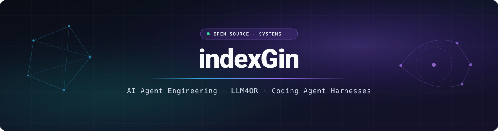

<!-- Generated & maintained with .github/scripts/refresh_profile.py -->

  

  

  
  
  

## 👋 关于我

你好，我是 **ChengFa（indexGin）**，专注于 **AI Agent 工程架构** 与 **大模型运筹优化（LLM4OR）**。

我关注智能体如何走出玩具 Demo、在真实状态空间中可靠运行：包括 **Coding Agent Harness 设计**（[PCode](https://github.com/indexGin/PCode)）、**多渠道自托管智能体工作台**（[dotclaw](https://github.com/indexGin/dotclaw)）、**Agent 原生客户经营系统**（[CustMate](https://github.com/indexGin/CustMate)），以及大模型与运筹求解器（Gurobi）结合的自动建模与双向验证。

🌱 我也持续向主流 AI Agent 与基础设施开源社区贡献代码，在生产级代码库中打磨安全边界、工作流编排与工程可靠性。

<!-- AUTO:STATS:START -->

  
  
  
  

<!-- AUTO:STATS:END -->

## 🛠️ 技术栈

  

---

## 🔧 上游贡献 · 已合并

<table width="100%">
  <tr>
    <td width="50%" valign="top">
      🛡️ <strong>执行安全与权限边界</strong> 
      修复工具只读权限回归、认证头脱敏与凭证域名白名单校验。 
      <a href="https://github.com/agentscope-ai/agentscope/pull/3474">AgentScope #3474</a> · <a href="https://github.com/n8n-io/n8n/pull/43061">n8n #43061</a> · <a href="https://github.com/n8n-io/n8n/pull/43291">n8n #43291</a>
    </td>
    <td width="50%" valign="top">
      🔄 <strong>工作流与长程调度</strong> 
      修复单次调度边界、流式游标回放空洞及 K8s 工作区命名冲突。 
      <a href="https://github.com/bytedance/deer-flow/pull/6686">DeerFlow #6686</a> · <a href="https://github.com/bytedance/deer-flow/pull/6812">#6812</a> · <a href="https://github.com/agentscope-ai/agentscope/pull/4029">AgentScope #4029</a>
    </td>
  </tr>
  <tr>
    <td width="50%" valign="top">
      🧩 <strong>参数解析与 Schema 契约</strong> 
      规范 URL/OpenAPI 路径拼接、模型卡片 Schema 对齐与工具名截断。 
      <a href="https://github.com/langgenius/dify/pull/45647">Dify #45647</a> · <a href="https://github.com/langgenius/dify/pull/46155">#46155</a> · <a href="https://github.com/n8n-io/n8n/pull/43286">n8n #43286</a>
    </td>
    <td width="50%" valign="top">
      🔌 <strong>观测追踪与工程稳定性</strong> 
      修复 Tracing 非有限浮点序列化、分页单测覆盖与 UTF-8 编码保留。 
      <a href="https://github.com/agentscope-ai/agentscope/pull/4179">AgentScope #4179</a> · <a href="https://github.com/QwenLM/qwen-code/pull/12560">QwenCode #12560</a> · <a href="https://github.com/agno-agi/agno/pull/10480">Agno #10480</a>
    </td>
  </tr>
</table>

📊 查看每日自动同步的上游项目统计明细

<!-- AUTO:TABLE:START -->
| Project | ★ | Language | Merged |
| :--- | ---: | :--- | ---: |
| &nbsp;[`n8n-io/n8n`](https://github.com/n8n-io/n8n) Fair-code workflow automation platform with native AI capabilities. Combine visual building… | 212.1k |  | [5](https://github.com/n8n-io/n8n/pulls?q=is%3Apr+is%3Amerged+author%3AindexGin) |
| &nbsp;[`langgenius/dify`](https://github.com/langgenius/dify) Build Agentic workflows, RAG pipelines, with rich AI model and tool support on one… | 161.9k |  | [6](https://github.com/langgenius/dify/pulls?q=is%3Apr+is%3Amerged+author%3AindexGin) |
| &nbsp;[`bytedance/deer-flow`](https://github.com/bytedance/deer-flow) An open-source long-horizon SuperAgent harness that researches, codes, and creates. With… | 85.8k |  | [4](https://github.com/bytedance/deer-flow/pulls?q=is%3Apr+is%3Amerged+author%3AindexGin) |
| &nbsp;[`agno-agi/agno`](https://github.com/agno-agi/agno) The self-managing agent platform | 43.3k |  | [1](https://github.com/agno-agi/agno/pulls?q=is%3Apr+is%3Amerged+author%3AindexGin) |
| &nbsp;[`agentscope-ai/agentscope`](https://github.com/agentscope-ai/agentscope) Build and run agents you can see, understand and trust. | 36.7k |  | [15](https://github.com/agentscope-ai/agentscope/pulls?q=is%3Apr+is%3Amerged+author%3AindexGin) |
| 

… and 2 more
 &nbsp;[`QwenLM/qwen-code`](https://github.com/QwenLM/qwen-code) An open-source AI coding agent that lives in your terminal. · 1 merged &nbsp;[`Kludex/starlette`](https://github.com/Kludex/starlette) The little ASGI framework that shines. 🌟 · 1 merged
 | 43.7k | — | 2 |

Public merged PRs in upstream projects with 1,000+ stars. Stars belong to the projects. Counts link to the merged PRs. Updated daily · 2026-11-25 UTC.
<!-- AUTO:TABLE:END -->

## 🚀 项目实践

- **[CustMate](https://github.com/indexGin/CustMate)** — 为 AI Agent 而生的开源客户经营系统（Customer OS）。以真实 CRM 为状态空间，让 Agent 读取客户与商机、消费知识与记忆、调用工具把业务真正推进。
- **[dotclaw](https://github.com/indexGin/dotclaw)** — 自托管、Pi Agent 驱动的多渠道智能体工作台（self-hosted AI agent workspace on the Pi Agent Runtime）。把 Agent、工作区、记忆、工具、渠道与自动化任务组织在同一个可控的运行环境中。
- **[PCode](https://github.com/indexGin/PCode)** — 极简但完整的 Coding Agent Harness（基于 Pi、TypeScript 与 ESM，约 6k 行），以可读的方式完整呈现生产级 Coding Agent 的核心子系统。

---

## 📈 近期活跃度

<!-- AUTO:ACTIVITY:START -->

  
  
  

<!-- AUTO:ACTIVITY:END -->

  <picture>
    <source media="(prefers-color-scheme: dark)" srcset="https://raw.githubusercontent.com/indexGin/indexGin/main/assets/contribution-snake-dark.svg" />
    
  </picture>

Past 90 days activity &amp; 1-year contribution snake · [Refresh workflow](.github/workflows/refresh.yml).

---

  
  
  

