<!-- Generated by .github/scripts/refresh_profile.py. -->

## Open source contributions

My merged contributions to open source, grouped by project.

  
  
  

| Project | ★ | Language | Merged |
| :--- | ---: | :--- | ---: |
| &nbsp;[`langgenius/dify`](https://github.com/langgenius/dify) Build Agentic workflows, RAG pipelines, with rich AI model and tool support on one… | 160.4k |  | [1](https://github.com/langgenius/dify/pulls?q=is%3Apr+is%3Amerged+author%3AindexGin) |
| &nbsp;[`bytedance/deer-flow`](https://github.com/bytedance/deer-flow) An open-source long-horizon SuperAgent harness that researches, codes, and creates. With… | 85.0k |  | [4](https://github.com/bytedance/deer-flow/pulls?q=is%3Apr+is%3Amerged+author%3AindexGin) |
| &nbsp;[`agno-agi/agno`](https://github.com/agno-agi/agno) The self-driving agent platform | 43.1k |  | [1](https://github.com/agno-agi/agno/pulls?q=is%3Apr+is%3Amerged+author%3AindexGin) |
| &nbsp;[`agentscope-ai/agentscope`](https://github.com/agentscope-ai/agentscope) Build and run agents you can see, understand and trust. | 35.4k |  | [1](https://github.com/agentscope-ai/agentscope/pulls?q=is%3Apr+is%3Amerged+author%3AindexGin) |
| &nbsp;[`QwenLM/qwen-code`](https://github.com/QwenLM/qwen-code) An open-source AI coding agent that lives in your terminal. | 29.0k |  | [1](https://github.com/QwenLM/qwen-code/pulls?q=is%3Apr+is%3Amerged+author%3AindexGin) |
| 

… and 1 more
 &nbsp;[`Kludex/starlette`](https://github.com/Kludex/starlette) The little ASGI framework that shines. 🌟 · 1 merged
 | 12.7k | — | 1 |

Public merged PRs in upstream projects with 1,000+ stars. Stars belong to the projects. Counts link to the merged PRs. Updated daily · 2026-11-05 UTC.

## Contribution graph

Last 90 days of activity, counted by GitHub.

  
  
  

  <picture>
    <source media="(prefers-color-scheme: dark)" srcset="https://raw.githubusercontent.com/indexGin/indexGin/main/assets/contribution-snake-dark.svg" />
    
  </picture>

The animated calendar shows the past year. [Refresh workflow](.github/workflows/refresh.yml).
